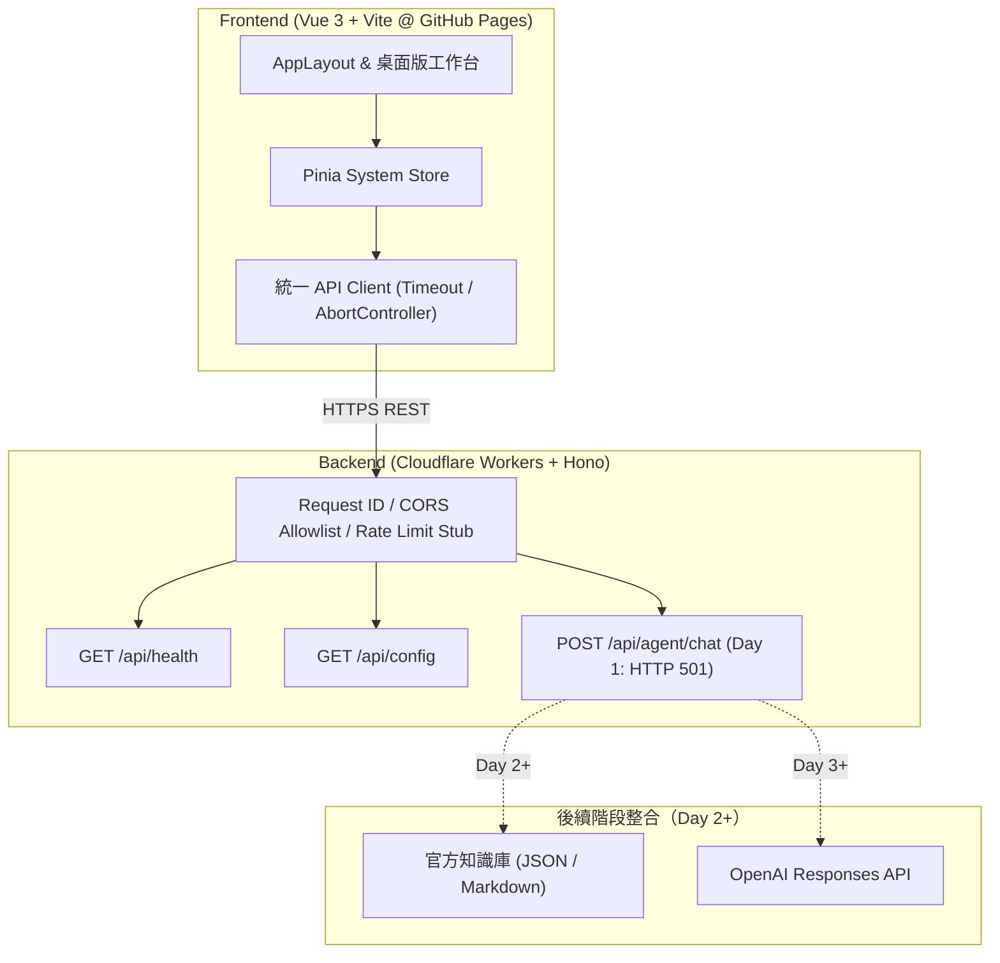

# SafeAgent — AI 產業安全與風險評估助手

**AI Industrial Safety & Risk Assessment Agent（研究概念驗證 / Proof of Concept）**

SafeAgent 為個人開源跨領域研究專案，作為陽明交通大學產業安全與防災碩士在職專班之備審作品展示，探索如何結合資訊系統工程、AI Agent 工具呼叫架構與職業安全衛生知識，建立具有即時分析與來源追溯能力的職業安全輔助工具。

> **免責聲明**：本系統為自主學習與研究概念驗證用途，非正式職業安全衛生評估工具，亦不得取代合格職業安全衛生人員之專業判斷或法定作業安全許可。

---

## 開發動機

> 「本專案源於資訊技術與產業安全的跨領域學習構想，希望透過 AI Agent、知識檢索及風險評估方法，探索人工智慧在危害辨識、設備安全及產業防災上的應用可行性。」

---

## 核心功能（分階段建置）

1. **AI 危害辨識**（開發中）：根據作業情境描述，協助辨識潛在危害與可能後果。
2. **職安知識檢索**（規劃中）：檢索具備官方資料來源與更新日期的職業安全衛生知識。
3. **風險矩陣評估**（規劃中）：透過發生可能性與後果嚴重度，協助進行初步風險評估與改善前後對照。
4. **職災案例分析**（規劃中）：透過公開職災案例，了解事故原因與預防措施。

---

## 技術架構

- **Frontend**：Vue 3 (`<script setup>`)、TypeScript、Vite、Vue Router (Hash History)、Pinia、Tailwind CSS、Lucide Vue Next
- **Backend**：Cloudflare Workers、TypeScript、Hono、Wrangler
- **AI Agent（Day 3+）**：OpenAI Responses API、Single Agent Architecture、Function Calling、Structured Outputs
- **Knowledge Base（Day 2+）**：JSON、Markdown（暫不使用關聯式或向量資料庫）
- **Monorepo & CI/CD**：npm workspaces、Vitest、ESLint、GitHub Actions、GitHub Pages

### Architecture Diagram



---

## 專案目錄

```text
safeagent/
├── .github/workflows/      # CI 與 GitHub Pages 部署設定
├── apps/
│   ├── web/                # Vue 3 前端應用
│   └── worker/             # Cloudflare Workers (Hono) 後端 API
├── packages/
│   └── shared/             # 前後端共用 TypeScript 型別
├── knowledge/              # Day 2 預留職安知識庫與案例目錄
├── docs/                   # 架構、Roadmap 與官方資料來源清單
├── AGENTS.md               # AI Coding Agent 長期開發規範
├── package.json            # npm workspaces 根設定
└── package-lock.json
```

---

## 本機啟動方式

### 1. 安裝相依套件

```bash
npm ci
```

### 2. 設定環境變數範本

```bash
cp apps/web/.env.example apps/web/.env
cp apps/worker/.dev.vars.example apps/worker/.dev.vars
```

### 3. 同時啟動前端與後端

```bash
npm run dev
```

- 前端開發網址：`http://localhost:5173`
- 後端 API 網址：`http://localhost:8787`（例如 `http://localhost:8787/api/health`）

### 4. 驗證指令

```bash
npm run typecheck
npm run lint
npm run test
npm run build
```

---

## 環境變數設定

### Frontend (`apps/web/.env.example`)

| 變數名稱 | 說明 | 預設值 |
| --- | --- | --- |
| `VITE_API_BASE_URL` | 後端 Worker API 基礎網址 | `http://localhost:8787` |
| `VITE_APP_VERSION` | 前端顯示版本號 | `0.1.0` |
| `VITE_GITHUB_REPOSITORY_URL` | GitHub Repository 連結（未設定時側邊欄不顯示無效連結） | 空字串 |

### Backend (`apps/worker/.dev.vars.example`)

| 變數名稱 | 說明 | 預設值 |
| --- | --- | --- |
| `OPENAI_API_KEY` | OpenAI API 金鑰（僅放後端 Secret，禁止進入前端或 Git） | 空字串 |
| `OPENAI_MODEL` | 未來使用的模型名稱 | 空字串 |
| `ALLOWED_ORIGINS` | CORS 允許來源清單（逗號分隔） | `http://localhost:5173` |
| `AGENT_ENABLED` | 是否啟用 Live Agent | `false` |

---

## 部署方式

### GitHub Pages（Frontend）

1. 於 GitHub Repository 設定 **Settings → Pages → Source: GitHub Actions**。
2. 於 **Settings → Secrets and variables → Actions → Variables** 設定 `VITE_API_BASE_URL`（指向部署後的 Worker 網域）。
3. Workflow（`.github/workflows/deploy-pages.yml`）已設定 `VITE_BASE_PATH=/<repository-name>/` 與 Vue Router Hash History，推送至 `main` 分支或手動觸發即可完成建置與部署。

### Cloudflare Workers（Backend）

1. 確認已登入 Wrangler（`npx wrangler login`）。
2. 設定正式環境 Secret（**勿寫入設定檔**）：
   ```bash
   npx wrangler secret put OPENAI_API_KEY --config apps/worker/wrangler.jsonc
   ```
3. 更新 `apps/worker/wrangler.jsonc` 中的 `ALLOWED_ORIGINS` 為實際 GitHub Pages 網域（例如 `https://<username>.github.io`）。
4. 執行部署：`npm run deploy --workspace=apps/worker`。

---

## 開發 Roadmap

詳細階段規劃請參閱 [docs/ROADMAP.md](docs/ROADMAP.md)。

- Day 1：專案初始化與基礎架構（已完成）
- Day 2：官方職安資料蒐集與知識庫
- Day 3：OpenAI Live Agent 與 Function Calling
- Day 4：風險矩陣與結構化報告
- Day 5：SSE Streaming 與 Agent Execution Trace
- Day 6：Agent 測試與評估
- Day 7：正式部署與備審展示優化

---

## 資料來源與研究限制

- **待查證資料來源**：請參閱 [docs/DATA_SOURCES.md](docs/DATA_SOURCES.md)。
- **研究限制**：Day 1 階段尚未串接 OpenAI API 與正式職安知識庫資料；系統無法取得完整現場環境條件，且不具正式作業許可審查效力。
- **免責聲明**：本系統產出或展示之任何資訊均僅供學術研究與自主學習參考，正式作業請依職業安全衛生法規並由合格專業人員評估辦理。
