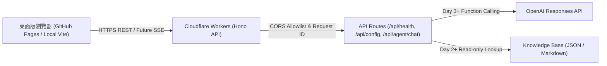

# SafeAgent 系統架構文件（Architecture）

## 1. 整體前後端架構

SafeAgent 採用前後端分離架構：

- **Frontend (`apps/web`)**：Vue 3 + TypeScript + Vite 靜態單頁應用（SPA），使用 Hash History (`createWebHashHistory`) 以相容 GitHub Pages Repository Subpath 部署，透過統一的 `ApiClient` 呼叫後端 REST API。
- **Backend (`apps/worker`)**：Cloudflare Workers + Hono 提供輕量無狀態 REST API（`/api/health`、`/api/config`、`/api/agent/chat`），並預留 SSE Streaming 與 Rate Limiting Middleware 擴充介面。
- **Shared Package (`packages/shared`)**：提供前後端共用的 TypeScript 型別定義（API Request / Response、Error Format、SSE Event 與 Workspace Schema）。



## 2. Monorepo 設計（npm workspaces）

```text
safeagent/
├── apps/
│   ├── web/        # Vue 3 前端應用
│   └── worker/     # Cloudflare Workers 後端 API
├── packages/
│   └── shared/     # 共用 TypeScript 型別定義
├── knowledge/      # Day 2 建置之職安知識與案例資料
├── docs/           # 架構、路線圖與資料來源文件
└── .github/        # CI 與 GitHub Pages 自動化部署 Workflow
```

根目錄透過 `package.json` workspaces 管理相依套件與鎖定檔 `package-lock.json`，並統一提供 `dev`、`build`、`lint`、`typecheck` 與 `test` 指令。

## 3. API 呼叫流程

1. 前端啟動進入 `AppLayout` 時，Pinia `useSystemStore` 透過 `health.service.ts` 與 `config.service.ts` 平行呼叫 `GET /api/health` 與 `GET /api/config`。
2. `ApiClient` 統一管理 `VITE_API_BASE_URL`、預設 5 秒逾時（`AbortController`）及結構化錯誤轉換（`ApiClientError`）。
3. 若後端未啟動或連線逾時，`useSystemStore` 切換為 `disconnected` 狀態，Header 與首頁系統面板顯示「後端未連線」，前端所有靜態頁面與介面骨架仍可正常操作瀏覽。
4. 後端所有 `/api/*` 請求皆經過 `requestIdMiddleware`、`corsAllowlistMiddleware` 與預留的 `rateLimitMiddleware`，錯誤回應統一採用 `{ error: { code, message }, requestId }` 格式。

## 4. GitHub Pages 部署架構

- `apps/web/vite.config.ts` 讀取 `VITE_BASE_PATH` 環境變數（GitHub Actions 中設定為 `/<repository-name>/`），確保靜態資源與 subpath 一致。
- Vue Router 使用 `createWebHashHistory()`，避免直接重新整理頁面或分享路由時於 GitHub Pages 產生 404。
- `.github/workflows/deploy-pages.yml` 僅請求最小必要權限（`contents: read`、`pages: write`、`id-token: write`），透過 GitHub Repository Variables 注入 `VITE_API_BASE_URL`。

## 5. OpenAI Single Agent 整合架構（Day 3 已實作）

- 採用 **Single Agent Architecture** 搭配 **OpenAI Responses API**（`/v1/responses`）與 **Function Calling + Structured Outputs**（`text.format` 嚴格 JSON Schema）。
- 不使用 LangChain 或 LangGraph，由 Worker 端（`apps/worker/src/agent/responses-client.ts`）直接控制工具執行循環（上限 4 輪，單次 OpenAI 請求逾時 25 秒；前端 `sendAgentChat` 逾時 60 秒）。
- 多輪對話狀態透過 OpenAI Responses API 原生 `previous_response_id` 串接（由後端回傳 `conversationId` 供前端下一輪附帶，無須伺服器端 Session 儲存）。
- Day 4 已啟用全部五個工具：`search_safety_knowledge`、`search_accident_cases`、`identify_hazards`、`calculate_risk`（需 `userConfirmedConditions=true`）、`generate_report`。
- 5×5 風險矩陣確定性規則統一維護於 `packages/shared/src/risk-matrix.ts`（1–5 低風險、6–14 中風險、15–25 高風險不可接受），供後端 API（`POST /api/risk/calculate`、`POST /api/risk/report`）與前端 `RiskMatrixView.vue` + Apache ECharts 視覺化共用。
- 工具執行狀態透過 `POST /api/agent/chat/stream` 搭配 `apps/worker/src/services/sse.ts` 即時串流（`agent.status`、`tool.started`、`tool.completed`、`message.delta`、`message.completed`、`error`）回傳前端 `WorkspaceView.vue`，即時更新工具執行耗時與官方引用來源（不公開模型內部推理過程）。
- Day 6 基準測試與評估框架位於 `knowledge/evaluation/benchmark-cases.json` 與 `apps/worker/src/services/evaluation.service.ts`（`GET /api/evaluation`、`POST /api/evaluation/run`）。

## 6. Secret 管理方式

- 本機開發：於 `apps/worker/.dev.vars` 設定 `OPENAI_API_KEY`、`OPENAI_MODEL` 與 `AGENT_ENABLED=true`（已列入 `.gitignore`，禁止提交至 Git）。
- 正式環境：透過 `wrangler secret put OPENAI_API_KEY` 儲存於 Cloudflare Workers Secret，不寫入 `wrangler.jsonc`。
- 前端環境變數（`VITE_*`）僅放置公開網址與版本號，嚴禁放置任何 API Key 或敏感憑證。

## 7. 已知技術限制（Day 6）

- 尚未完成 Cloudflare Workers 正式環境線上部署（預定於 Day 7 與使用者確認後執行）。
- `rateLimitMiddleware` 目前為 pass-through 預留介面，尚未綁定 Cloudflare Rate Limiting 規則，尚不具備真實限流防護。
- 前端僅針對桌面版視窗（1280×800 以上）設計，未包含手機或平板版面適配。
